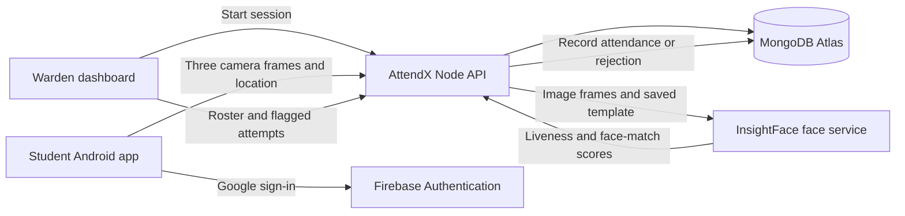

<div align="center">
  
  <h1>AttendX</h1>
  <p><strong>A calmer hostel roll call.</strong></p>
  <p>Students check in from Android. Wardens open sessions and see the roster from a browser.</p>
  <p>
    <a href="https://linktr.ee/vyomg20082005">Download the app · Warden portal</a>
    &nbsp;·&nbsp;
    <a href="https://attendx-mobile.vercel.app/">Open warden dashboard</a>
    &nbsp;·&nbsp;
    <a href="https://attend-x-xi.vercel.app/health">Check API health</a>
    &nbsp;·&nbsp;
    <a href="https://attendxfaceservice.vercel.app/health">Check face service</a>
  </p>
</div>

AttendX is a student project for hostel attendance. It brings together a student mobile app, a warden dashboard, a Node.js API, MongoDB, Firebase Authentication, and a Python face-verification service.

### At a glance

| 👨‍🎓 Student | 🧑‍💼 Warden | 🧠 Verification | ☁️ Hosting |
| --- | --- | --- | --- |
| Android APK with Google sign-in, camera-only check-in, and foreground location. | Opens and closes sessions, views present/away students and rooms, reviews rejected attempts, and exports CSV. | InsightFace embeddings, liveness classification, cosine similarity, and a server-checked geofence. | Vercel for API, face service, and web app; EAS Build for Android. |

## Live AttendX

| Service | Link | What it is |
| --- | --- | --- |
| AttendX links | [linktr.ee/vyomg20082005](https://linktr.ee/vyomg20082005) | Linktree page with the Android app download and warden portal. |
| Warden dashboard | [attendx-mobile.vercel.app](https://attendx-mobile.vercel.app/) | Google sign-in, open/close sessions, live roster, flagged check-in attempts, CSV export. |
| Node API health | [attend-x-xi.vercel.app/health](https://attend-x-xi.vercel.app/health) | API and MongoDB connectivity status. |
| Face service health | [attendxfaceservice.vercel.app/health](https://attendxfaceservice.vercel.app/health) | InsightFace model and liveness-service status. |
| Student app | Android APK distributed privately | Students sign in and submit attendance from their phone. |

The current public web deployment is built from `mobile/` and includes the warden screen. `admin/` is a separate Vite web client in the repository; it is not the deployment linked above.

## How attendance works

An attendance check-in is a short request chain across the phone, API, face service, and database. The API owns the final decision: the client supplies evidence (camera frames and a location fix), while the backend checks it against server-side policy and saved student data.



### 1 · The warden opens roll call

The warden signs in with Google. Firebase returns an identity token; the AttendX API verifies it and checks the account's server-side `admin` role and hostel assignment. Creating a session writes its title, start time, end time, status, and hostel ID to `attendanceSessions`.

### 2 · The student opens the session

The student signs in with the Google account linked to an active AttendX user. The app asks the API for the active session and the student's profile. A student must have an imported face template before attendance can be submitted.

### 3 · The app captures evidence

The app takes three still images in quick succession using the front camera, then asks for a fresh foreground location fix. It sends the three `captures`, active `sessionId`, coordinates, accuracy, and timestamp as a multipart request to `POST /attendance`. The app does not let students choose images from the gallery.

### 4 · The API checks the request

Before inference, the API verifies the signed-in user's student role, requires exactly three image frames, checks that the session belongs to the student's hostel and is open, rejects duplicate check-ins, and validates the location timestamp, GPS accuracy, and distance from the configured geofence. It loads the student's saved face template from MongoDB.

### 5 · Python checks each frame

For each frame, the API sends the image and the stored template to `POST /v1/verify` on the face service. The Python service decodes the image, requires one detected face, runs the liveness add-on, extracts a face embedding, and returns a cosine similarity score. A frame that fails liveness or face extraction is rejected.

### 6 · The API records the result

All three frames must pass liveness. The Node API takes the **median** of the three face-match scores and compares it with `FACE_MATCH_THRESHOLD` (currently configured as `0.70`). If the check passes, it inserts one `present` record with the verification policy and a minimized location summary. A unique database index prevents a second record for that student and session. If a check fails, the API returns a clear error and records a reason code in `auditEvents`.

The warden dashboard reads session rosters and rejected-attempt events from the API. It shows students as present or away, room numbers, and the most recent rejected attempts for the selected session. “Flagged” means **rejected check-ins for review**; it does not claim a failed check-in proves misconduct.

## Project map

| Directory | Purpose |
| --- | --- |
| `mobile/` | Expo Router student app, phone warden screen, and the web build currently deployed to Vercel. |
| `admin/` | Standalone Vite warden portal client. |
| `api/` | Node.js 22+ and Express API, MongoDB access, Firebase token verification, roster import tools. |
| `face-service/` | Python FastAPI service using InsightFace for face embeddings, liveness, and matching. |
| `.env.example` | Root backend configuration template; contains placeholders only. |

## Technology

- **Mobile and web:** Expo SDK 58, React Native, Expo Router, TypeScript.
- **Warden portal:** React, TypeScript, Vite (in `admin/`).
- **API:** Node.js, Express, MongoDB Node driver.
- **Database:** MongoDB Atlas.
- **Authentication:** Firebase Authentication with Google sign-in; the API validates Firebase ID tokens and checks server-side account roles.
- **Face service:** Python, FastAPI, OpenCV, InsightFace `buffalo_l`, ONNX Runtime, liveness add-on.
- **Hosting:** Vercel for the API, face service, and current web deployment; EAS Build for Android APKs.

## Face templates and privacy

The local roster importer processes reference photos into a normalized 512-number face embedding (template) for each student and saves the template with the student record in MongoDB. The importer does not save the original reference photos to MongoDB. Attendance captures are held in memory while being checked and are not written to disk or stored in MongoDB.

The database stores student and user records, face templates, hostel/geofence settings, attendance sessions, attendance records, and audit events. Rejected-attempt audit events contain safe reason codes and request metadata, not the submitted images. The API does not trust client-provided “face passed” or “location passed” flags.

Liveness and face matching reduce some forms of misuse but are not perfect proof of identity or presentation. Thresholds and geofence settings need careful validation with representative captures and real GPS accuracy before relying on them.

**Model terms:** InsightFace code and its pretrained weights have separate terms. The public `buffalo_l` pretrained pack is restricted to non-commercial research use according to the [InsightFace model-zoo notice](https://github.com/deepinsight/insightface/tree/master/model_zoo). Check the [liveness add-on terms](https://github.com/deepinsight/insightface/blob/master/python-package/docs/liveness.md) as well.

## Python face service · code review

The Python service is an inference service; it does **not train or fine-tune** a face-recognition model on AttendX students. InsightFace's pretrained `buffalo_l` model produces embeddings. AttendX reference photos are used only to build and save one enrollment template per student.

### The code path

| File | Role in the flow |
| --- | --- |
| [`face-service/face_service/face_engine.py`](face-service/face_service/face_engine.py) | Loads InsightFace once per worker, extracts live embeddings, builds enrollment templates, validates templates, and computes similarity. |
| [`face-service/face_service/api.py`](face-service/face_service/api.py) | Defines health, enrollment-template, and verification HTTP endpoints; validates image type, byte size, pixel count, and template JSON. |
| [`face-service/app.py`](face-service/app.py) | Vercel entry point. It includes a compatibility adapter for missing `scikit-image` typing stubs in Vercel's Python bundle, then exports the FastAPI app. |
| [`face-service/main.py`](face-service/main.py) | Local sample-folder runner for comparing enrollment photos with verification photos. It does not serve HTTP requests or write templates to MongoDB. |

### What `FaceEngine` does

1. **Load once:** `FaceEngine.__init__` creates `FaceAnalysis(name="buffalo_l", addons=["liveness"])` and prepares detection at `640 × 640`. The API creates a module-level engine when its worker starts, so a warm worker reuses the loaded model.
2. **Find one face:** `get_live_embedding_from_image` calls InsightFace and rejects images with zero or multiple detected faces.
3. **Check liveness:** It requires a liveness result with status `ok` and `is_live == True`. Missing, rejected, or fake classifications return a reason instead of an embedding.
4. **Normalize the embedding:** It reads the model's face vector and divides it by its L2 norm. A zero-length vector is rejected.
5. **Build an enrollment template:** `create_template_from_images` keeps usable embeddings, requires at least three, averages them, and normalizes the mean. The API endpoint accepts 3–10 enrollment images and returns the template plus any rejected-image reasons.
6. **Compare a check-in:** `verify_image` converts the saved template to `float32`, rejects malformed, non-finite, zero-length, or wrong-shaped templates, extracts the live capture embedding, and returns the dot product between the two normalized vectors.

For normalized vectors, the dot product is cosine similarity:

```text
similarity = dot(capture_embedding, enrollment_template)
```

It is a **similarity score, not a probability**. The Python service returns a score; the Node API applies the configured threshold and three-frame median policy.

```text
Enrollment photos ──> liveness + embedding per photo ──> mean ──> normalize ──> MongoDB template
                                                                              │
Three camera frames ──> liveness + embedding per frame ──> cosine scores ──> median + threshold
                                                                              │
                                                                       attendance decision
```

The verification endpoint returns a small JSON result on a successful frame, for example:

```json
{
  "status": "liveness_passed",
  "similarity": 0.82,
  "model": "buffalo_l"
}
```

The number shown is illustrative, not a calibrated identity probability. The API client makes three requests (one for each capture), and rejects the attendance submission if a frame is not live or the median match score is below policy.

### Review notes: what is solid and what needs care

| Area | Review |
| --- | --- |
| Input checks | The HTTP layer limits uploads to 8 MB, allows JPEG/PNG content types, rejects invalid decoded images, and caps image dimensions at 12 million pixels. Enrollment is limited to 3–10 photos. |
| Embedding checks | Embeddings and templates are normalized; template values are checked for finite numbers, nonzero norm, and the expected shape before comparison. |
| Model reuse | The module-level engine avoids loading the neural models for every request on a warm worker. A cold Vercel worker still has to initialize the model, which can make the first verification slower. |
| Reference template | Averaging several normalized references is a compact baseline. The quality of the result still depends on clear, varied reference photos; one poor or filtered photo can pull the average away from the student's face. |
| Liveness strength | The current liveness check classifies each still image. Three stills are stronger than one for consistency checks, but they are not a randomized motion challenge and should not be described as foolproof anti-spoofing. |
| Request execution | Inference is CPU-heavy and runs synchronously inside an async FastAPI route. This is acceptable for the small demo workload; higher concurrent traffic should use controlled worker execution and measured capacity. |
| Service boundary | The Node API is expected to call the face service, but the Python routes currently do not authenticate that caller. Add service-to-service authentication or private networking before broadening exposure. |
| Health route | `/health` confirms the app and model initialized sufficiently to serve. It does not measure recognition accuracy or test a real capture end to end. |

The local validation script and endpoint errors help debug the pipeline, but they do not replace threshold calibration with independent same-person and different-person captures. Scores vary with capture quality, lighting, pose, and model behavior; `0.70` is a project setting, not a universal safe cutoff.

## Local development

### Requirements

- Node.js 22 or newer for `api/`; Node.js 24.12 or newer for `admin/`.
- Python 3.11 recommended for `face-service/`.
- MongoDB Atlas access and a Firebase project with Google sign-in enabled.
- A physical Android phone for camera, location, and native Google sign-in checks.

### 1. Configure local environment files

Copy the templates, then fill in your own values locally:

```bash
cp .env.example .env
cp mobile/.env.example mobile/.env
cp admin/.env.example admin/.env
```

The root `.env` contains server-only variables such as `MONGODB_URI`, Firebase Admin credentials, geofence policy, and `FACE_SERVICE_URL`. The client `.env` files contain only public Firebase web configuration and API base URLs. **Never commit real `.env` files or Firebase Admin service-account keys.**

For a phone on the same Wi-Fi as your development computer, set `EXPO_PUBLIC_API_URL` in `mobile/.env` to the computer's LAN address, such as `http://192.168.1.20:3000`. Set `API_HOST=0.0.0.0` in the root `.env` so the phone can reach the local API. `localhost` on the phone points to the phone itself.

### 2. Start the face service

From the repository root:

```bash
cd face-service
python3 -m venv .venv
source .venv/bin/activate
pip install -r requirements.txt
python -m uvicorn face_service.api:app --host 127.0.0.1 --port 8000
```

The first run may download model files. Keep this terminal open while using the locally hosted API. Check `http://127.0.0.1:8000/health` or open `http://127.0.0.1:8000/docs`.

### 3. Start the API

In another terminal, from the repository root:

```bash
cd api
npm ci
npm run dev
```

Check `http://localhost:3000/health`. A healthy local response includes `"database":"connected"`.

### 4. Start the Expo app

In another terminal:

```bash
cd mobile
npm ci
npx expo start
```

Use the locally installed development APK for native Google sign-in. Expo Go does not provide the native Google sign-in setup used by this project. To run the web version locally, use `npx expo start --web`.

### Optional: run the standalone Vite portal

The `admin/` client is separate from the Expo web route. Configure `admin/.env`, then run:

```bash
cd admin
npm ci
npm run dev
```

Vite prints a local URL (usually `http://localhost:5173`). Add that origin to `WEB_ORIGINS` in the API environment if using this client.

## Student roster and embeddings

The private manifest `api/students.json` maps AttendX student IDs and names to reference-photo folders. It is gitignored. Reference photos belong under `face-service/samples/enrollment/<student-folder>/` and are gitignored too.

For each student, use 3–10 clear JPEG or PNG photos. To import or refresh templates, start the face service, configure the root `.env` with the local face-service URL and MongoDB URI, then run:

```bash
cd api
npm run import:students
```

The importer creates or updates student templates and account records. The API also supports syncing roster details (such as room numbers) without regenerating embeddings:

```bash
cd api
npm run sync:roster
```

Keep the photo folders and `api/students.json` private. Do not upload students' reference or verification photos to GitHub.

## API overview

All API routes are served from the Node API base URL.

| Method | Route | Purpose |
| --- | --- | --- |
| `GET` | `/health` | API and MongoDB health. |
| `POST` | `/auth/firebase-session` | Exchange a verified Firebase Google sign-in for an AttendX API session. |
| `POST` | `/auth/dev-session` | Development-only sign-in when explicitly enabled. |
| `GET` | `/me` | Current account and face-profile state. |
| `GET` | `/sessions/active` | Current open attendance session for the student. |
| `POST` | `/attendance` | Submit three camera captures and a location fix for server-side verification. |
| `GET` | `/attendance/me` | The signed-in student's records and recent rejected attempts. |
| `POST` | `/admin/sessions` | Create an attendance session. |
| `GET` | `/admin/sessions` | List sessions visible to the signed-in warden. |
| `PATCH` | `/admin/sessions/:id` | Update or close a session. |
| `GET` | `/admin/sessions/:id/attendance` | Present/away roster for a session. |
| `GET` | `/admin/sessions/:id/attempts` | Recent rejected-attempt reason codes. |
| `GET` | `/admin/sessions/:id/export` | Download the session roster as CSV. |
| `PATCH` | `/admin/sessions/:id/attendance/:attendanceId/review` | Attach a manual-review note to a record. |

The API applies authentication and role checks to admin routes. A unique `{ studentId, sessionId }` index prevents duplicate attendance records for one student in one session.

## Deployment overview

The current public deployments are:

- **API:** `https://attend-x-xi.vercel.app`
- **Face service:** `https://attendxfaceservice.vercel.app`
- **Web dashboard:** `https://attendx-mobile.vercel.app`
- **Android:** EAS `preview` profile builds an internally distributed APK.

Production configuration is entered in each hosting service's environment settings, not in Git. Important server variables include `MONGODB_URI`, `FACE_SERVICE_URL`, `WEB_ORIGINS`, `AUTH_TOKEN_SECRET`, `AUTH_TOKEN_LIFETIME_SECONDS`, `FIREBASE_PROJECT_ID`, `FIREBASE_CLIENT_EMAIL`, `FIREBASE_PRIVATE_KEY`, and the `HOSTEL_*` geofence settings. The API's `WEB_ORIGINS` must include the deployed web origin. Firebase Authentication's authorized domains must include the dashboard's hostname.

The web build from `mobile/` uses the `EXPO_PUBLIC_API_URL` and `EXPO_PUBLIC_FIREBASE_*` values at build time. The Android EAS build also needs `EXPO_PUBLIC_API_URL` in the EAS `preview` environment. Public Firebase client config may be included in a client build; Firebase Admin private credentials and MongoDB credentials must remain server-side.

To build a new Android APK from `mobile/`:

```bash
cd mobile
npx eas-cli build --platform android --profile preview
```

The current APK supports camera capture, foreground location, and Google sign-in. **Push notifications are not implemented yet**; adding them will require notification credentials and a new Android build.

## Warden administration

Only accounts with the `admin` role can manage sessions or view hostel reports. Google sign-in does not automatically grant admin access. Assign roles from a trusted local terminal using the API scripts. For example:

```bash
cd api
npm run grant-admin -- student_01
```

Replace the example ID with the intended account. Use the separate-account helper if the warden needs a distinct admin identity:

```bash
cd api
npm run create-admin -- admin_vyom "Warden Name" warden@example.com student_01
```

The final argument is the existing student ID whose Google email should be moved to the separate admin account. Replace it with the intended source account ID.

The API access token lifetime is controlled by `AUTH_TOKEN_LIFETIME_SECONDS` (the example default is seven days). Firebase-backed sign-in must use an email already linked to an active AttendX user.

## Environment variable reference

| Variable | Used by | Notes |
| --- | --- | --- |
| `MONGODB_URI` | API, import scripts | MongoDB Atlas connection string; secret. |
| `FACE_SERVICE_URL` | API | Base URL of the Python face service. |
| `WEB_ORIGINS` | API | Comma-separated browser origins allowed by CORS. |
| `AUTH_TOKEN_SECRET` | API | Private signing secret; keep server-side. |
| `AUTH_TOKEN_LIFETIME_SECONDS` | API | AttendX API token duration. |
| `FIREBASE_PROJECT_ID` | API | Firebase project used to verify ID tokens. |
| `FIREBASE_CLIENT_EMAIL` | API | Firebase Admin service-account email. |
| `FIREBASE_PRIVATE_KEY` | API | Firebase Admin service-account private key; secret. |
| `HOSTEL_ID`, `HOSTEL_NAME` | API | Hostel identity and display name. |
| `HOSTEL_CENTER_LAT`, `HOSTEL_CENTER_LON` | API | Geofence center; keep real values out of public docs. |
| `HOSTEL_RADIUS_METERS` | API | Allowed distance from geofence center. |
| `HOSTEL_MAX_ACCURACY_METERS`, `HOSTEL_MAX_FIX_AGE_SECONDS` | API | Location quality limits. |
| `FACE_MATCH_THRESHOLD` | API | Minimum face-match score policy. |
| `EXPO_PUBLIC_API_URL` | Expo app | API base URL compiled into the app. |
| `EXPO_PUBLIC_FIREBASE_*` | Expo web sign-in | Public Firebase Web app config; no Admin key. |
| `VITE_API_URL`, `VITE_FIREBASE_*` | `admin/` client | Config for the separate Vite portal only. |

Use `.env.example`, `mobile/.env.example`, and `admin/.env.example` as templates. Do not paste production secret values into documentation, issues, or source control.

## Current roadmap

- Add push notifications when the warden opens a session; students will need to install a newly built APK.
- Continue testing camera, liveness, location, Google sign-in, and attendance across devices and networks.
- Tune and document face-match and geofence thresholds using real test outcomes.

## License and project use

AttendX is a personal student project and is not intended for commercial use. The model and dependency licenses still apply; consult their upstream notices before redistributing model files or changing the project's use.
