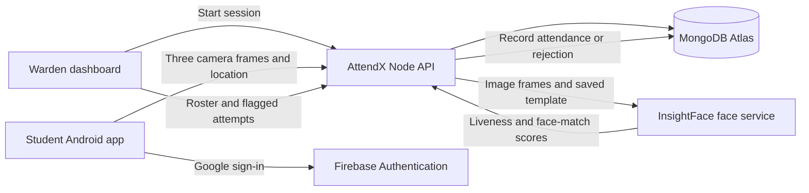

# AttendX

> **A calmer hostel roll call.** Students check in from the AttendX Android app; wardens open attendance sessions and see the roster from a browser.

AttendX is a student project for hostel attendance. It combines a student mobile app, a warden dashboard, a Node.js API, MongoDB, and a Python face-verification service.

## Live AttendX

| Service | Link | What it is |
| --- | --- | --- |
| Warden dashboard | [attendx-mobile.vercel.app](https://attendx-mobile.vercel.app/) | Google sign-in, open/close sessions, live roster, flagged check-in attempts, CSV export. |
| Node API health | [attend-x-xi.vercel.app/health](https://attend-x-xi.vercel.app/health) | API and MongoDB connectivity status. |
| Face service health | [attendxfaceservice.vercel.app/health](https://attendxfaceservice.vercel.app/health) | InsightFace model and liveness-service status. |
| Student app | Android APK distributed privately | Students sign in and submit attendance from their phone. |

The current public web deployment is built from `mobile/` and includes the warden screen. `admin/` is a separate Vite web client in the repository; it is not the deployment linked above.

## How attendance works



1. A warden signs in with an authorized Google account and opens an attendance session.
2. A student signs in with the Google account linked to their active AttendX record.
3. During an open session, the student captures three images with the in-app front camera and submits a fresh location fix. There is no gallery upload path.
4. The API checks the session, student account, hostel geofence, and duplicate-attendance rule. It sends each image to the face service for liveness and matching checks.
5. The API records attendance only when the checks pass. It records rejected attempts with reason codes so the warden can review them.

The warden dashboard shows students as present or away, their room numbers, and the most recent rejected attempts for the selected session. A rejected attempt is a review signal; it is not by itself proof of misconduct.

## Project map

| Directory | Purpose |
| --- | --- |
| `mobile/` | Expo Router student app, phone warden screen, and the web build currently deployed to Vercel. |
| `admin/` | Standalone Vite warden portal client. |
| `api/` | Node.js 22+ and Express API, MongoDB access, Firebase token verification, roster import tools. |
| `face-service/` | Python FastAPI service using InsightFace for face embeddings, liveness, and matching. |
| `.env.example` | Root backend configuration template; contains placeholders only. |

## Technology

- **Mobile and web:** Expo SDK 58, React Native, Expo Router, TypeScript.
- **Warden portal:** React, TypeScript, Vite (in `admin/`).
- **API:** Node.js, Express, MongoDB Node driver.
- **Database:** MongoDB Atlas.
- **Authentication:** Firebase Authentication with Google sign-in; the API validates Firebase ID tokens and checks server-side account roles.
- **Face service:** Python, FastAPI, OpenCV, InsightFace `buffalo_l`, ONNX Runtime, liveness add-on.
- **Hosting:** Vercel for the API, face service, and current web deployment; EAS Build for Android APKs.

## Face templates and privacy

The local roster importer processes reference photos into a normalized 512-number face embedding (template) for each student and saves the template with the student record in MongoDB. The importer does not save the original reference photos to MongoDB. Attendance captures are held in memory while being checked and are not written to disk or stored in MongoDB.

The database stores student and user records, face templates, hostel/geofence settings, attendance sessions, attendance records, and audit events. Rejected-attempt audit events contain safe reason codes and request metadata, not the submitted images. The API does not trust client-provided “face passed” or “location passed” flags.

Liveness and face matching reduce some forms of misuse but are not perfect proof of identity or presentation. Thresholds and geofence settings need careful validation with representative captures and real GPS accuracy before relying on them.

**Model terms:** InsightFace code and its pretrained weights have separate terms. The public `buffalo_l` pretrained pack is restricted to non-commercial research use according to the [InsightFace model-zoo notice](https://github.com/deepinsight/insightface/tree/master/model_zoo). Check the [liveness add-on terms](https://github.com/deepinsight/insightface/blob/master/python-package/docs/liveness.md) as well.

## Local development

### Requirements

- Node.js 22 or newer for `api/`; Node.js 24.12 or newer for `admin/`.
- Python 3.11 recommended for `face-service/`.
- MongoDB Atlas access and a Firebase project with Google sign-in enabled.
- A physical Android phone for camera, location, and native Google sign-in checks.

### 1. Configure local environment files

Copy the templates, then fill in your own values locally:

```bash
cp .env.example .env
cp mobile/.env.example mobile/.env
cp admin/.env.example admin/.env
```

The root `.env` contains server-only variables such as `MONGODB_URI`, Firebase Admin credentials, geofence policy, and `FACE_SERVICE_URL`. The client `.env` files contain only public Firebase web configuration and API base URLs. **Never commit real `.env` files or Firebase Admin service-account keys.**

For a phone on the same Wi-Fi as your development computer, set `EXPO_PUBLIC_API_URL` in `mobile/.env` to the computer's LAN address, such as `http://192.168.1.20:3000`. Set `API_HOST=0.0.0.0` in the root `.env` so the phone can reach the local API. `localhost` on the phone points to the phone itself.

### 2. Start the face service

From the repository root:

```bash
cd face-service
python3 -m venv .venv
source .venv/bin/activate
pip install -r requirements.txt
python -m uvicorn face_service.api:app --host 127.0.0.1 --port 8000
```

The first run may download model files. Keep this terminal open while using the locally hosted API. Check `http://127.0.0.1:8000/health` or open `http://127.0.0.1:8000/docs`.

### 3. Start the API

In another terminal, from the repository root:

```bash
cd api
npm ci
npm run dev
```

Check `http://localhost:3000/health`. A healthy local response includes `"database":"connected"`.

### 4. Start the Expo app

In another terminal:

```bash
cd mobile
npm ci
npx expo start
```

Use the locally installed development APK for native Google sign-in. Expo Go does not provide the native Google sign-in setup used by this project. To run the web version locally, use `npx expo start --web`.

### Optional: run the standalone Vite portal

The `admin/` client is separate from the Expo web route. Configure `admin/.env`, then run:

```bash
cd admin
npm ci
npm run dev
```

Vite prints a local URL (usually `http://localhost:5173`). Add that origin to `WEB_ORIGINS` in the API environment if using this client.

## Student roster and embeddings

The private manifest `api/students.json` maps AttendX student IDs and names to reference-photo folders. It is gitignored. Reference photos belong under `face-service/samples/enrollment/<student-folder>/` and are gitignored too.

For each student, use 3–10 clear JPEG or PNG photos. To import or refresh templates, start the face service, configure the root `.env` with the local face-service URL and MongoDB URI, then run:

```bash
cd api
npm run import:students
```

The importer creates or updates student templates and account records. The API also supports syncing roster details (such as room numbers) without regenerating embeddings:

```bash
cd api
npm run sync:roster
```

Keep the photo folders and `api/students.json` private. Do not upload students' reference or verification photos to GitHub.

## API overview

All API routes are served from the Node API base URL.

| Method | Route | Purpose |
| --- | --- | --- |
| `GET` | `/health` | API and MongoDB health. |
| `POST` | `/auth/firebase-session` | Exchange a verified Firebase Google sign-in for an AttendX API session. |
| `POST` | `/auth/dev-session` | Development-only sign-in when explicitly enabled. |
| `GET` | `/me` | Current account and face-profile state. |
| `GET` | `/sessions/active` | Current open attendance session for the student. |
| `POST` | `/attendance` | Submit three camera captures and a location fix for server-side verification. |
| `GET` | `/attendance/me` | The signed-in student's records and recent rejected attempts. |
| `POST` | `/admin/sessions` | Create an attendance session. |
| `GET` | `/admin/sessions` | List sessions visible to the signed-in warden. |
| `PATCH` | `/admin/sessions/:id` | Update or close a session. |
| `GET` | `/admin/sessions/:id/attendance` | Present/away roster for a session. |
| `GET` | `/admin/sessions/:id/attempts` | Recent rejected-attempt reason codes. |
| `GET` | `/admin/sessions/:id/export` | Download the session roster as CSV. |
| `PATCH` | `/admin/sessions/:id/attendance/:attendanceId/review` | Attach a manual-review note to a record. |

The API applies authentication and role checks to admin routes. A unique `{ studentId, sessionId }` index prevents duplicate attendance records for one student in one session.

## Deployment overview

The current public deployments are:

- **API:** `https://attend-x-xi.vercel.app`
- **Face service:** `https://attendxfaceservice.vercel.app`
- **Web dashboard:** `https://attendx-mobile.vercel.app`
- **Android:** EAS `preview` profile builds an internally distributed APK.

Production configuration is entered in each hosting service's environment settings, not in Git. Important server variables include `MONGODB_URI`, `FACE_SERVICE_URL`, `WEB_ORIGINS`, `AUTH_TOKEN_SECRET`, `AUTH_TOKEN_LIFETIME_SECONDS`, `FIREBASE_PROJECT_ID`, `FIREBASE_CLIENT_EMAIL`, `FIREBASE_PRIVATE_KEY`, and the `HOSTEL_*` geofence settings. The API's `WEB_ORIGINS` must include the deployed web origin. Firebase Authentication's authorized domains must include the dashboard's hostname.

The web build from `mobile/` uses the `EXPO_PUBLIC_API_URL` and `EXPO_PUBLIC_FIREBASE_*` values at build time. The Android EAS build also needs `EXPO_PUBLIC_API_URL` in the EAS `preview` environment. Public Firebase client config may be included in a client build; Firebase Admin private credentials and MongoDB credentials must remain server-side.

To build a new Android APK from `mobile/`:

```bash
cd mobile
npx eas-cli build --platform android --profile preview
```

The current APK supports camera capture, foreground location, and Google sign-in. **Push notifications are not implemented yet**; adding them will require notification credentials and a new Android build.

## Warden administration

Only accounts with the `admin` role can manage sessions or view hostel reports. Google sign-in does not automatically grant admin access. Assign roles from a trusted local terminal using the API scripts. For example:

```bash
cd api
npm run grant-admin -- student_01
```

Replace the example ID with the intended account. Use the separate-account helper if the warden needs a distinct admin identity:

```bash
cd api
npm run create-admin -- admin_vyom "Warden Name" warden@example.com student_01
```

The final argument is the existing student ID whose Google email should be moved to the separate admin account. Replace it with the intended source account ID.

The API access token lifetime is controlled by `AUTH_TOKEN_LIFETIME_SECONDS` (the example default is seven days). Firebase-backed sign-in must use an email already linked to an active AttendX user.

## Environment variable reference

| Variable | Used by | Notes |
| --- | --- | --- |
| `MONGODB_URI` | API, import scripts | MongoDB Atlas connection string; secret. |
| `FACE_SERVICE_URL` | API | Base URL of the Python face service. |
| `WEB_ORIGINS` | API | Comma-separated browser origins allowed by CORS. |
| `AUTH_TOKEN_SECRET` | API | Private signing secret; keep server-side. |
| `AUTH_TOKEN_LIFETIME_SECONDS` | API | AttendX API token duration. |
| `FIREBASE_PROJECT_ID` | API | Firebase project used to verify ID tokens. |
| `FIREBASE_CLIENT_EMAIL` | API | Firebase Admin service-account email. |
| `FIREBASE_PRIVATE_KEY` | API | Firebase Admin service-account private key; secret. |
| `HOSTEL_ID`, `HOSTEL_NAME` | API | Hostel identity and display name. |
| `HOSTEL_CENTER_LAT`, `HOSTEL_CENTER_LON` | API | Geofence center; keep real values out of public docs. |
| `HOSTEL_RADIUS_METERS` | API | Allowed distance from geofence center. |
| `HOSTEL_MAX_ACCURACY_METERS`, `HOSTEL_MAX_FIX_AGE_SECONDS` | API | Location quality limits. |
| `FACE_MATCH_THRESHOLD` | API | Minimum face-match score policy. |
| `EXPO_PUBLIC_API_URL` | Expo app | API base URL compiled into the app. |
| `EXPO_PUBLIC_FIREBASE_*` | Expo web sign-in | Public Firebase Web app config; no Admin key. |
| `VITE_API_URL`, `VITE_FIREBASE_*` | `admin/` client | Config for the separate Vite portal only. |

Use `.env.example`, `mobile/.env.example`, and `admin/.env.example` as templates. Do not paste production secret values into documentation, issues, or source control.

## Current roadmap

- Add push notifications when the warden opens a session; students will need to install a newly built APK.
- Continue testing camera, liveness, location, Google sign-in, and attendance across devices and networks.
- Tune and document face-match and geofence thresholds using real test outcomes.

## License and project use

AttendX is a personal student project and is not intended for commercial use. The model and dependency licenses still apply; consult their upstream notices before redistributing model files or changing the project's use.
